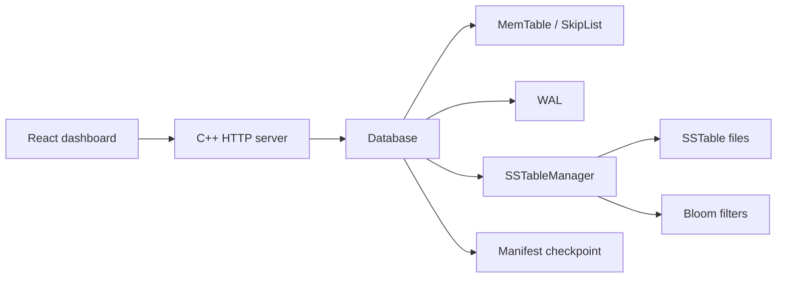
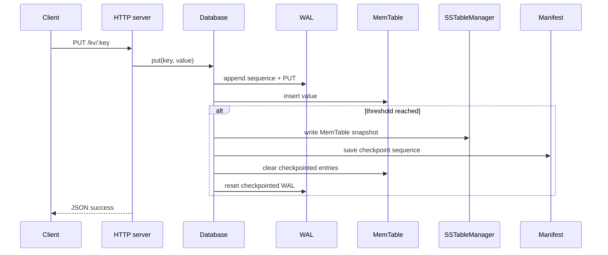
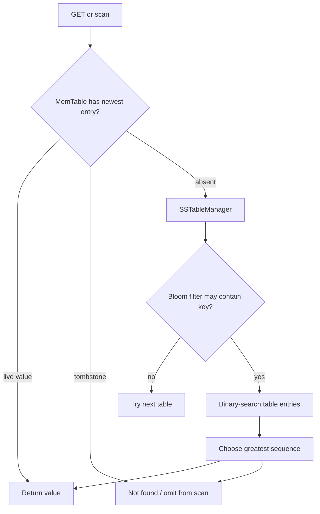
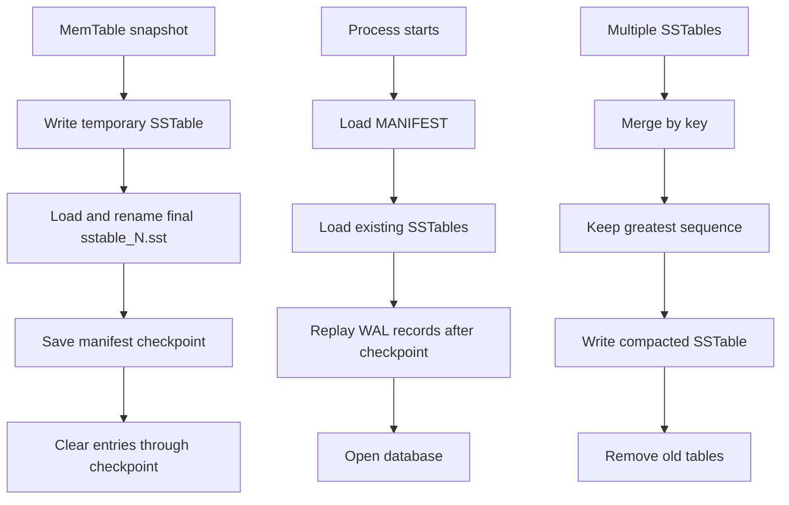
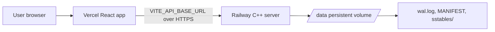

# StrataDB

## A persistent C++17 LSM-tree key-value engine

StrataDB is an educational but working persistent key-value storage engine. It combines a WAL, SkipList-backed MemTable, immutable SSTables, Bloom-filter-assisted lookups, sequence numbers, tombstones, manifest checkpoints, recovery, and compaction behind a small C++ HTTP API. A React + TypeScript dashboard provides CRUD operations, range scans, statistics, and a Data Explorer.

> **Deployment status:** the frontend runs on Vercel and the C++ backend runs on Railway with a persistent volume mounted at `/data`.

## Live links

- [Dashboard](https://frontend-amrit7.vercel.app/)
- [Backend health](https://stratadb-production.up.railway.app/health)
- [Backend records API](https://stratadb-production.up.railway.app/records)
- [GitHub repository](https://github.com/Amrittt22/StrataDB)

## Overview

Writes are appended to the WAL and applied to an in-memory MemTable. When the configured threshold is reached, the MemTable snapshot is written as an immutable SSTable, the manifest checkpoint advances, and checkpointed MemTable/WAL state is cleared. Reads merge the MemTable with all SSTables by sequence number. Deletes are represented by tombstones until compaction.

The implementation is intentionally small and inspectable:



## Key features

- Persistent PUT, GET, DELETE, and ordered range scan.
- Sequence-aware WAL replay and checkpoint recovery.
- SkipList MemTable with tombstone tracking.
- SSTable V3 binary format with values, tombstones, and sequence numbers.
- Bloom filters to skip SSTables that cannot contain a key.
- Explicit flush, automatic flush threshold, and compaction.
- REST API and a dark-theme React dashboard.
- Data Explorer backed by the actual `/records` endpoint.
- GoogleTest suite and a repeatable local benchmark executable.

## Architecture

### LSM-tree model

The engine uses a mutable in-memory level and immutable on-disk tables. SSTables are discovered from `sstables/sstable_<id>.sst` and managed newest-first. Visibility is resolved by the greatest sequence number for each key; tombstones are not returned as values.

### Write path



### Read path



### Flush, recovery, and compaction



## Storage engine components

- **Database:** coordinates MemTable, WAL, SSTableManager, and Manifest.
- **MemTable:** stores live values in a SkipList and tracks sequence numbers and tombstones.
- **SkipList:** ordered in-memory index with randomized levels up to 16.
- **WAL:** binary records containing operation, sequence, key length, value length, and payload. Incomplete tails are truncated during replay; malformed records fail recovery.
- **SSTable:** immutable sorted binary table with magic/version marker `STRATAS3`, bounded field sizes, tombstones, and sequence numbers.
- **BloomFilter:** two-hash probabilistic membership filter, configured for a 1% default false-positive target.
- **SSTableManager:** discovers, orders, loads, searches, writes, and compacts SSTables.
- **Manifest:** atomically replaces a checkpoint file containing magic `STRATAM1` and the latest checkpoint sequence.

More detail is in the [storage-engine documentation](docs/storage-engine/lsm-tree.md).

## Sequence numbers and tombstones

Every MemTable mutation receives a monotonically increasing `uint64_t` sequence number. A delete writes a tombstone with an empty value. Reads and scans compare sequence numbers across MemTable and SSTables; the newest tombstone hides older values. Compaction retains the newest entry, including tombstones, so deleted keys do not reappear.

## REST API

The server listens on `HOST` and `PORT` (defaults `127.0.0.1:8080`) and uses the first command-line argument as the data directory. Full request/response documentation and cURL examples are in [docs/backend/rest-api.md](docs/backend/rest-api.md).

| Method | Endpoint | Purpose |
|---|---|---|
| GET | `/health` | Health check |
| PUT | `/kv/:key` | Insert or update raw-text value |
| GET | `/kv/:key` | Retrieve one value |
| DELETE | `/kv/:key` | Write a tombstone |
| GET | `/scan?start=a&end=z` | Inclusive ordered range scan |
| GET | `/records` | Complete visible-record snapshot |
| GET | `/stats` | MemTable, SSTable, and last auto-flush status |

`/records` is not paginated by the backend. It returns all visible records in deterministic key order; the dashboard filters and paginates that snapshot locally.

## Data Explorer dashboard

The dashboard includes:

- Overview and connection status.
- CRUD operations for insert/update, retrieve, and delete.
- MemTable/SSTable/flush statistics.
- Range Scan with inclusive start and end keys.
- Data Explorer using `/records`.

Data Explorer sorts records by key, loads actual backend values, reports total records, provides case-insensitive key filtering, loading/error/empty states, refresh and retry actions, and uses browser-side pagination with a default page size of 25. Selecting a record opens full key/value details, UTF-8 byte size, JSON or Text type, pretty-printed valid JSON, plain-text fallback, and copy buttons. Copying does not transform the stored value.

See [docs/frontend/dashboard.md](docs/frontend/dashboard.md).

## Technology stack

| Area | Technology |
|---|---|
| Engine | C++17, CMake |
| HTTP | cpp-httplib |
| Tests | GoogleTest |
| Frontend | React 19, TypeScript, Vite |
| Hosting | Railway (backend), Vercel (frontend) |
| Persistence | WAL, SSTables, Railway volume |

## Project structure

```text
engine/
  include/                 Public engine headers
  src/                     Engine and HTTP server implementation
  tests/                   GoogleTest suite
  benchmarks/              Benchmark executable
frontend/
  src/App.tsx              Dashboard shell and CRUD/range/statistics views
  src/DataExplorer.tsx     Data Explorer
  src/api/stratadb.ts      Typed HTTP client
docs/                      Organized technical documentation
benchmarks/results/        Checked-in benchmark CSV
Dockerfile                 Railway container build
CMakeLists.txt             Engine, server, tests, and benchmark targets
```

## Build and installation

### Prerequisites

- C++17 compiler
- CMake 3.16 or newer
- Git
- Node.js and npm for the frontend

### Windows

```powershell
cmake -S . -B build
cmake --build build
```

### Linux/macOS

```bash
cmake -S . -B build
cmake --build build -j2
```

CMake downloads cpp-httplib and GoogleTest through `FetchContent`.

## Run locally

Start the backend with an isolated local directory:

```powershell
.\build\stratadb_server.exe .\stratadb_data 8080 1000
```

```bash
./build/stratadb_server ./stratadb_data 8080 1000
```

The arguments are data directory, port, and positive MemTable flush threshold. Never point destructive tests at Railway’s `/data` volume.

Start the frontend:

```powershell
cd frontend
npm install
$env:VITE_API_BASE_URL="http://localhost:8080"
npm run dev
```

The committed [`frontend/.env.example`](frontend/.env.example) contains the local default. Vite builds use `VITE_API_BASE_URL`; the API client defaults to `http://localhost:8080`.

## Tests

Build and run all discovered tests:

```powershell
cmake --build build
ctest --test-dir build --output-on-failure
```

The latest verified result is **110/110 tests passed**. Coverage includes SkipList, MemTable, WAL, SSTable, BloomFilter, Manifest/recovery, Database merge and tombstone behavior, automatic flushing, compaction, statistics, and project-level tests. The Data Explorer’s backend correctness is covered by the Database listing/merge test and the `/records` server path; browser interaction checks remain manual.

Frontend checks:

```powershell
cd frontend
npm run build
npm run lint
```

## Benchmarks

The benchmark creates temporary databases, verifies results, and writes CSV output:

```powershell
.\build\stratadb_benchmark.exe
.\build\stratadb_benchmark.exe 5000 .\benchmarks\results\custom.csv
```

The checked-in 1,000-record run in [`benchmarks/results/stratadb_benchmark.csv`](benchmarks/results/stratadb_benchmark.csv) reports:

| Operation | Throughput (ops/s) | Average | p50 | p95 | p99 |
|---|---:|---:|---:|---:|---:|
| PUT to MemTable | 1,358.043 | 736.354 us | 639.500 us | 1,715.900 us | 2,267.300 us |
| GET from SSTable | 299,025.178 | 3.344 us | 2.900 us | 5.000 us | 5.600 us |
| Range scan | 481.108 | 2,078.533 us | 1,943.500 us | 1,943.500 us | 1,943.500 us |
| Compaction | 33.717 | 29,658.800 us | 29,658.800 us | 29,658.800 us | 29,658.800 us |

These are local measurements, not production SLOs. Hardware, build mode, filesystem, and dataset shape affect results.

## Deployment architecture



The Dockerfile builds `stratadb_server` and starts it with `/data`. Railway supplies `PORT`; the container sets `HOST=0.0.0.0`. The frontend is configured with `VITE_API_BASE_URL=https://stratadb-production.up.railway.app`. The volume preserves database files across restarts and deployments. Deployment steps are in [docs/deployment/deployment-guide.md](docs/deployment/deployment-guide.md).

## Current limitations

- `/records` returns the complete visible dataset; filtering and pagination are frontend-side, so very large datasets are not bounded at the API boundary.
- HTTP handlers share one mutex, serializing storage operations and limiting concurrency.
- There is no authentication or authorization.
- The server enables `Access-Control-Allow-Origin: *`; deployment should restrict this before handling sensitive data.
- TLS is expected from the hosting proxy, not implemented in the C++ server.
- WAL appends flush the stream but do not expose an `fsync`/durability acknowledgement.
- Recovery validates and truncates incomplete WAL tails, but malformed records fail opening; there is no repair tool.
- Compaction is an explicit operation and does not run as a background scheduler.
- Bloom filters can produce false positives and only optimize lookups; they never establish key absence alone.
- The benchmark is a local baseline, not a distributed or production scalability test.

## Future improvements

Potential next steps are bounded server-side listing, authentication, restricted CORS, TLS-aware deployment policy, background compaction, richer observability, stronger durability controls, and larger-scale benchmark comparisons.

## Screenshots

No dashboard screenshots are currently stored in the repository. Capture these manually for portfolio documentation:

1. Overview dashboard
2. Data Explorer table
3. Record details panel
4. Range Scan
5. Statistics

## Documentation

Start at [docs/README.md](docs/README.md) for the documentation map. The primary comprehensive textbook remains preserved at [`docs/StrataDB_Textbook.pdf`](docs/StrataDB_Textbook.pdf); the linked Markdown chapters record the final `/records` API, Data Explorer, deployment, and verified test results.

## Author

Built by [Amritanshu](https://github.com/Amrittt22).
