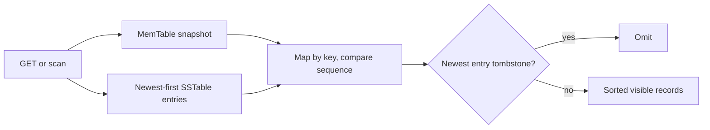

# Read path

Point reads first check the MemTable. A MemTable tombstone immediately hides older SSTable values. Otherwise the SSTable manager checks loaded tables using Bloom filters and binary search, selecting the highest sequence number.

Range scans and `/records` use the same merge mechanism. Entries from all SSTables and the MemTable are placed in a key-ordered map, newer sequence numbers replace older ones, tombstones are omitted, and the result is deterministic.

The `/records` endpoint returns the complete result set. It does not accept pagination parameters.
