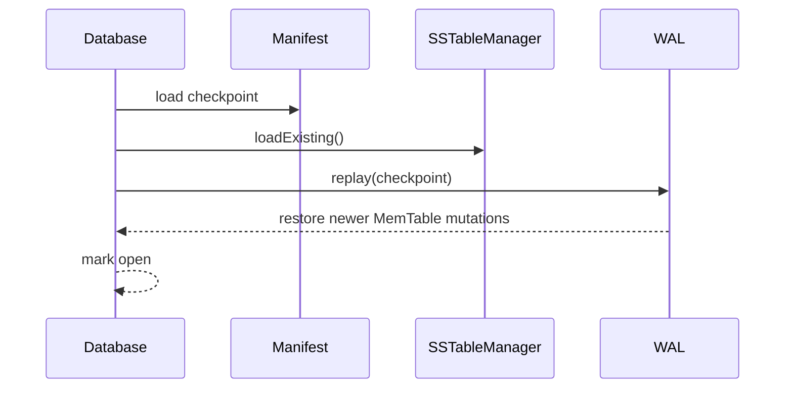

# Recovery and compaction

## Recovery

On construction, the database prepares the data paths and reads the manifest checkpoint. `open()` validates the manifest, discovers and loads SSTables, then the MemTable WAL replays only records with sequence numbers greater than the checkpoint. A missing manifest or WAL is treated as an empty database. A malformed manifest, SSTable, or invalid WAL record fails opening; an incomplete WAL tail is truncated to the last complete record.

## Compaction

`compact()` first flushes the MemTable, then `SSTableManager::compactAll()` merges all tables. For every key it retains the greatest sequence number, writes a new table, removes old table files, and retains the new table in newest-first order. Compaction is explicit; there is no background compaction scheduler.
