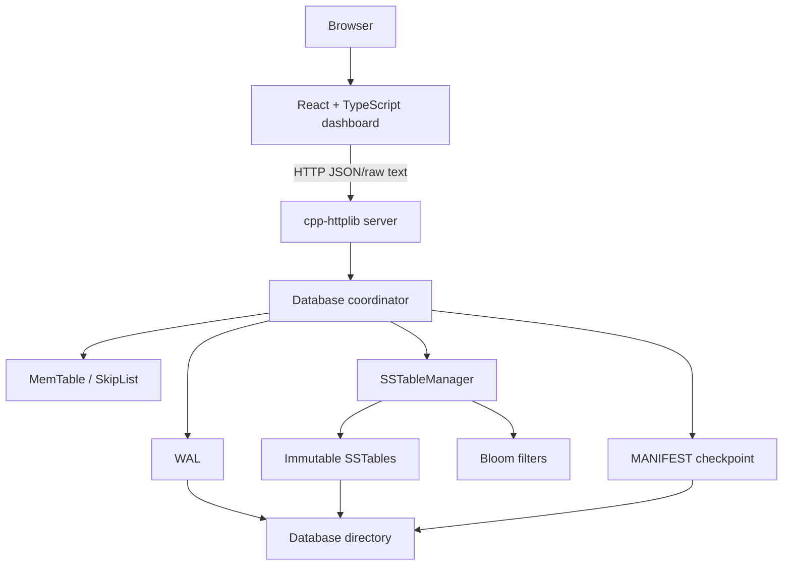

# System overview

StrataDB has three layers: a React/Vite client, a cpp-httplib server, and the storage engine.

`Database` owns one `MemTable`, `Manifest`, and `SSTableManager`. The server shares one `Database` instance across routes and protects operations with a global mutex. SSTable files are stored under `<data-directory>/sstables`; the WAL and manifest are directly under the data directory.

The deployed backend uses `/data`. Local development should use a separate directory such as `./stratadb_data`.
