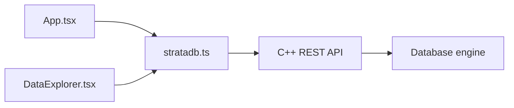

# React dashboard

The frontend is a Vite React + TypeScript application. [`frontend/src/api/stratadb.ts`](../../frontend/src/api/stratadb.ts) centralizes fetch calls and reads `VITE_API_BASE_URL`, defaulting to `http://localhost:8080`.

## Views

- **Overview:** welcome panel, backend connection state, and dashboard layout.
- **CRUD:** insert/update, retrieve, and delete a raw string value.
- **Statistics:** MemTable size, SSTable count, automatic flush status, and backend status.
- **Range Scan:** inclusive `start`/`end` query using `/scan`.
- **Data Explorer:** complete `/records` snapshot in a record table.

## Data Explorer behavior

`DataExplorer.tsx` requests `/records` on mount and refresh. It sorts by key with `localeCompare`, displays the backend record count, and exposes loading, retryable error, empty database, and no-search-match states.

Search is a client-side, case-insensitive substring filter over keys. It does not modify keys or issue a request for each keystroke. Pagination is also client-side because `/records` returns the complete snapshot; the default page size is 25 with 50 and 100 options.

Selecting a row opens the details panel. It shows the full key, exact full value, UTF-8 byte size, JSON/Text classification, pretty-printed JSON when `JSON.parse` succeeds, and unchanged plain text otherwise. Copy buttons write the exact key or value to the browser clipboard.

The frontend does not read WAL or SSTable files directly. Deleted records are absent because the backend filters tombstones and chooses the newest sequence.
